

<picture>
  <source media="(prefers-color-scheme: dark)" srcset="images/lockup-dark.png">
  
</picture>

### Intercept, edit and mock any API call — right inside Chrome

A free Chrome extension for **developers** and **QA engineers**. 
Capture network traffic, pause and edit requests and responses as plain fields, replay them on a loop with random data, mock APIs with rules, and export HAR files or a ready-made bug report.

 

 

<a href="https://inspectly-by-rehman-tahir.vercel.app">
  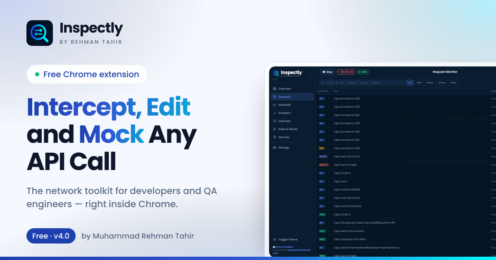
</a>

 

## Contents

- [What is Inspectly?](#what-is-inspectly)
- [Quick links](#quick-links)
- [Features](#features)
- [Screenshots](#screenshots)
- [Install in two minutes](#install-in-two-minutes)
- [How to use it](#how-to-use-it)
- [Who it is for](#who-it-is-for)
- [Privacy](#privacy)
- [FAQ](#faq)
- [What is new in v4.0](#what-is-new-in-v40)
- [About the author](#about-the-author)
- [More by the author — NuGet packages](#more-by-the-author--nuget-packages)

 

## What is Inspectly?

Inspectly is a network toolkit that lives in your browser. Press **Record** and it logs every API call your page makes. From there you can:

- **pause** a request or a response and change it before it continues,
- **edit** bodies and URL parameters as a list of typed fields instead of raw text,
- **replay** any call — once, or up to 1,000 times with a delay you choose and fresh random data on every send,
- **mock** an endpoint with a rule so the server is never called,
- **hand off** the evidence as a HAR file, a cURL command or a Markdown bug report.

It runs as a compact toolbar popup or a full dashboard. There is no account, no sign-up and no paid tier, and everything you capture stays on your machine.

 

## Quick links

| | |
|---|---|
| 🌐 **Website** | https://inspectly-by-rehman-tahir.vercel.app |
| ⬇️ **Download (ZIP)** | https://inspectly-by-rehman-tahir.vercel.app/downloads/inspectly-extension.zip |
| 📖 **Documentation** | https://inspectly-by-rehman-tahir.vercel.app/docs |
| ✨ **All features** | https://inspectly-by-rehman-tahir.vercel.app/features |
| 🧪 **Use cases** | https://inspectly-by-rehman-tahir.vercel.app/use-cases |
| ❓ **FAQ** | https://inspectly-by-rehman-tahir.vercel.app/faq |
| 📝 **Changelog** | https://inspectly-by-rehman-tahir.vercel.app/changelog |
| 🔒 **Privacy** | https://inspectly-by-rehman-tahir.vercel.app/privacy |

 

## Features

| Feature | What it does |
|---|---|
| **Capture every request** | Logs fetch, XHR and form submissions with full headers, payload, status and timing — including both hops of a redirect and POST bodies larger than 64 KB. |
| **Pause and edit requests and responses** | Matching traffic stops in a live queue. Change the URL, parameters, method, headers or body before a request leaves, or the status, headers and body before the page sees a response. |
| **Bodies become editable fields** | JSON, form data, XML and HTML are parsed into typed fields (string, integer, double, boolean, character). Switch to Raw whenever you want the text. |
| **Replay once — or on a loop** | Repeat count from 1 to 1,000, a fixed interval or a random delay between two values, and a log of every response. |
| **Random data on every send** | Mark a field with the dice and it gets a fresh value inside the range you set, each time the request is sent. |
| **Rules and API mocks** | Rules apply automatically: **mock** a response, **block** a request, **delay** it by up to 60 seconds, or add **headers**. Each rule shows how often it fired. |
| **Mock this response** | Turns any captured request into a mock rule in one click. |
| **HAR and JSON export** | HAR 1.2 for Chrome DevTools, Postman, Charles or Fiddler — or plain JSON. Bodies included. |
| **One-click bug report** | Copies a request as Markdown: summary, Expected / Actual, request, response and a cURL to reproduce. |
| **Passive security audit** | Flags missing security headers, weak cookie flags and exposed secrets, and decodes JWTs — using only traffic you already captured. |
| **Full dashboard** | Overview metrics, a request waterfall and analytics charts, in a tab, a floating window or full screen. Dark and light themes. |
| **Storage inspector** | localStorage, sessionStorage, Cache Storage and IndexedDB for the page you are testing. |

 

## Screenshots

### Request monitor

Every call with its method, status, type and time. Search, and filter by XHR, Fetch, errors or slow requests.

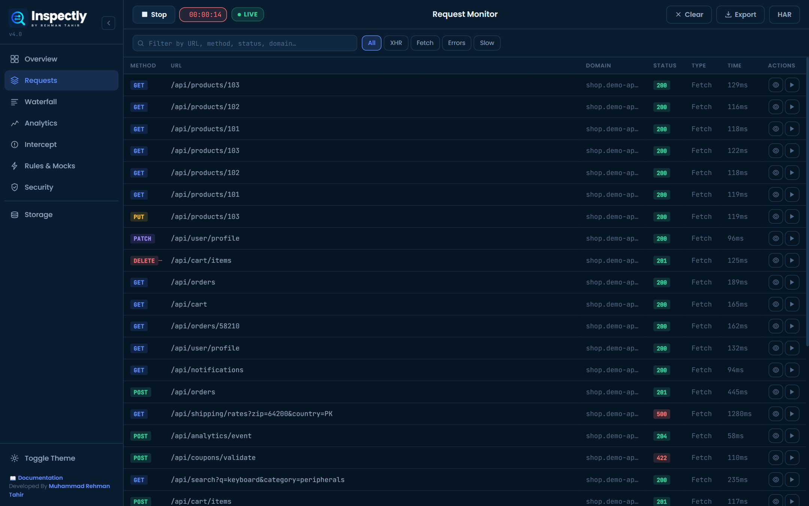

 

### Live overview

Totals, errors, average response time, slow and failed requests, top domains and HTTP methods — updating while you record.

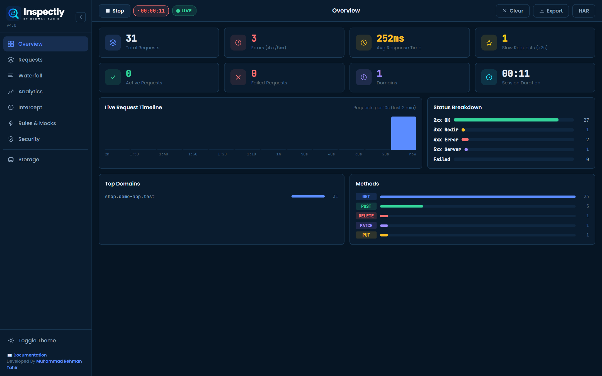

 

### Interception queue

Paused traffic waits here. `REQ` items are requests, `RES` items are responses. Forward, modify, block or duplicate each one — or forward them all.

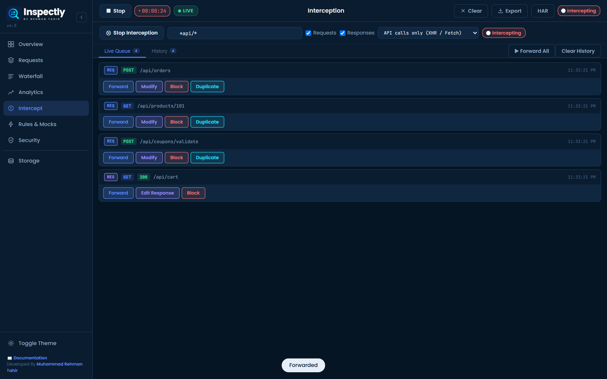

 

### Edit a response as fields

A paused response opens with its JSON body split into one field per value. Change a number, a string or the status code, then send the modified response to the page.

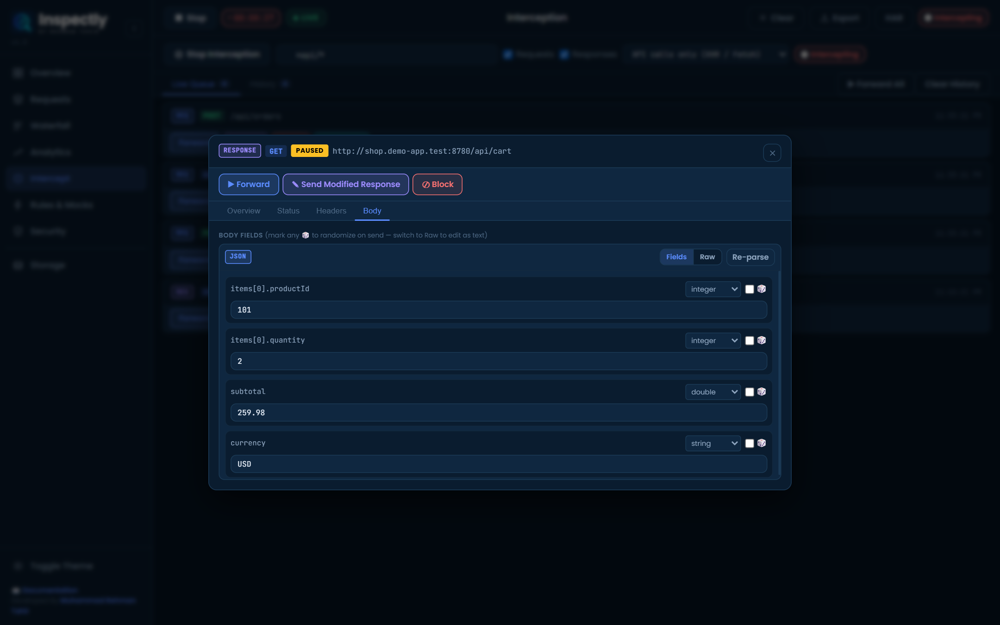

 

### Replay with random data

Here `quantity` is randomised between 1 and 25 and the request is sent 5 times, 0.2 seconds apart. Each response lands in the log.

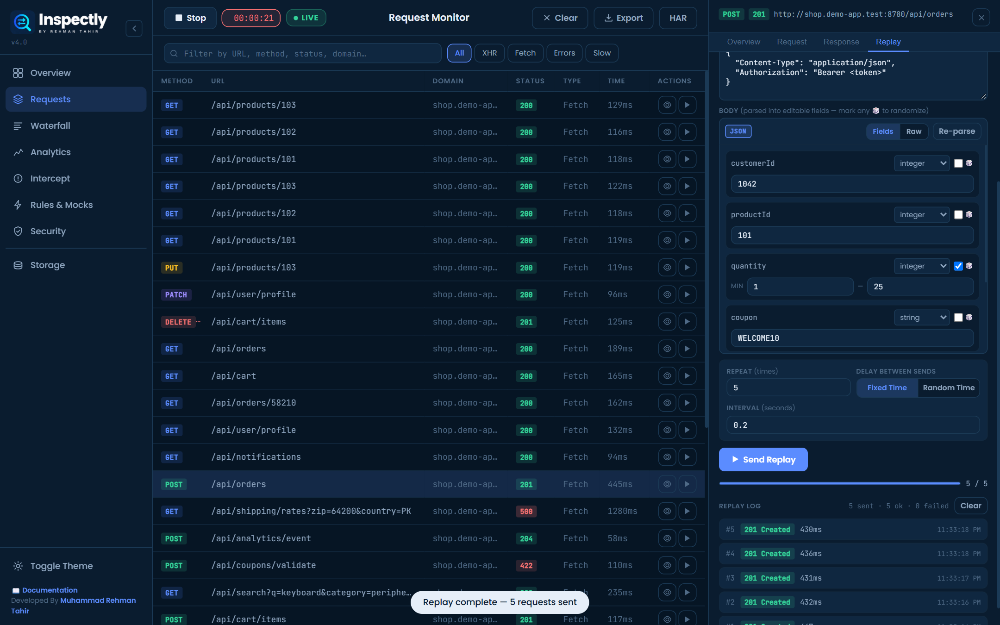

 

### Rules and mocks

Five rules running at once — two mocks, a delay, a block and a header rule — each with its hit counter.

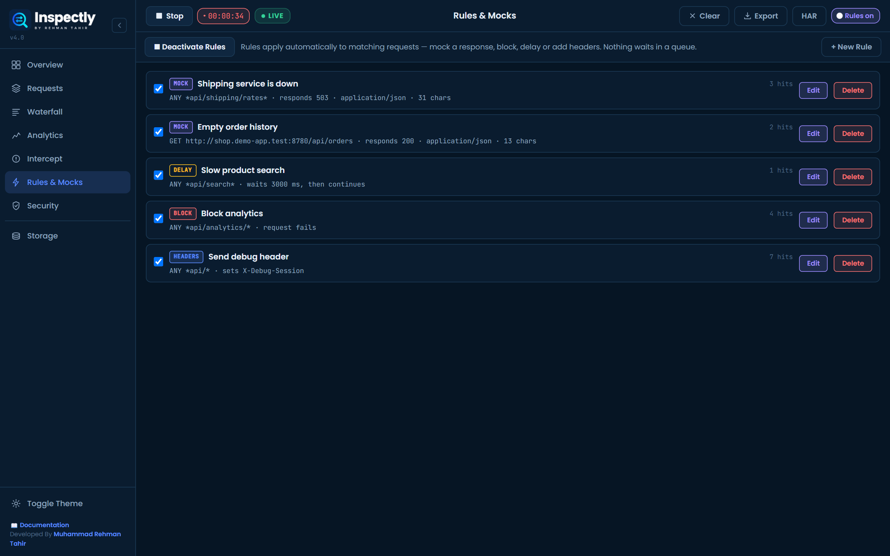

 

<table>
<tr>
<td width="50%" valign="top">

**Rule editor** — pre-filled from a captured request.

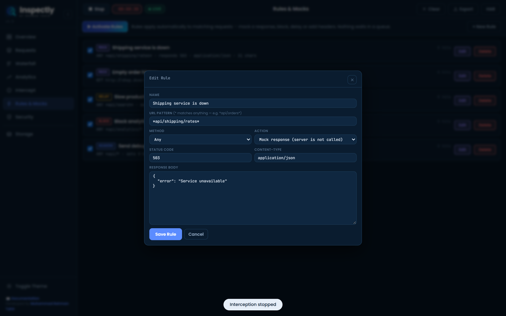

</td>
<td width="50%" valign="top">

**Request detail** — copy as cURL, copy a bug report, or mock the response.

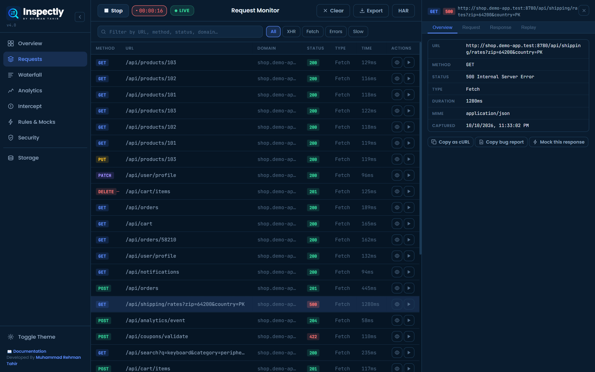

</td>
</tr>
<tr>
<td width="50%" valign="top">

**Security audit** — headers, cookies, secrets and JWTs.

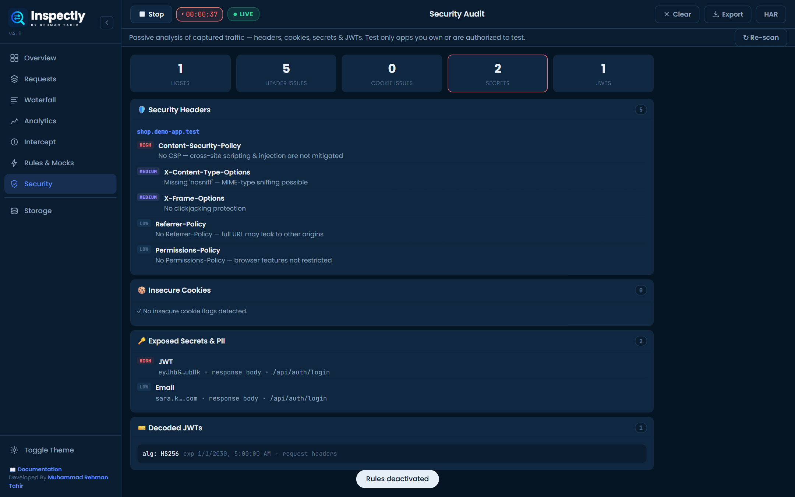

</td>
<td width="50%" valign="top">

**Analytics** — response-time distribution and slowest requests.

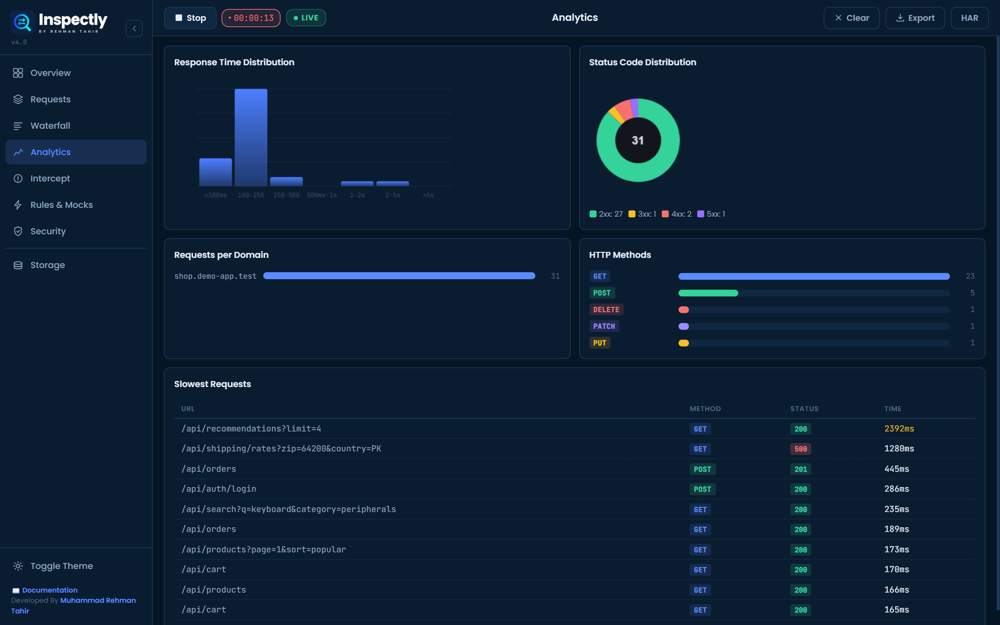

</td>
</tr>
<tr>
<td width="50%" valign="top">

**Waterfall** — waiting and receiving time on one timeline.

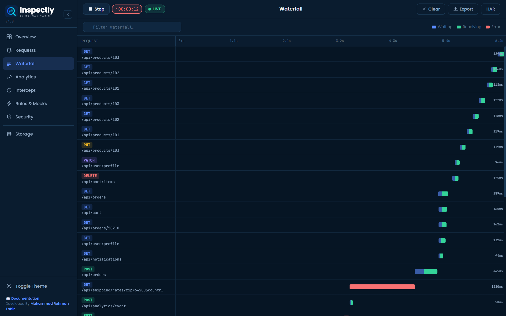

</td>
<td width="50%" valign="top">

**Toolbar popup** — every tool one click away.

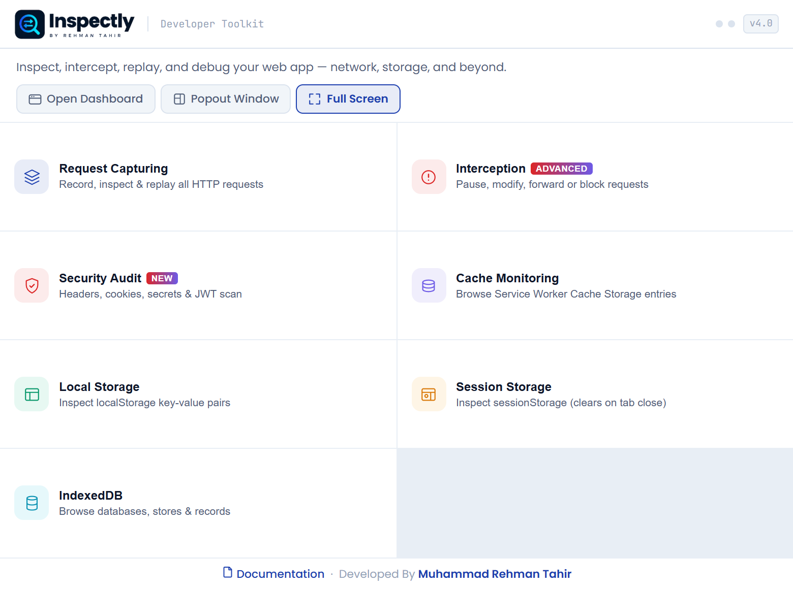

</td>
</tr>
</table>

 

## Install in two minutes

Inspectly is not on the Chrome Web Store. You load it from a ZIP — no installer, no build step.

1. **Download the ZIP** — [inspectly-extension.zip](https://inspectly-by-rehman-tahir.vercel.app/downloads/inspectly-extension.zip).
2. **Unzip it somewhere permanent**, such as `Documents/inspectly`. Chrome disables the extension if the folder is moved or deleted.
3. **Open `chrome://extensions`** and switch on **Developer mode** (top-right corner).
4. **Click Load unpacked** and choose the unzipped folder — the one that contains `manifest.json`. Pin the Inspectly icon to your toolbar.
5. **Record.** Open the site you want to test, click the Inspectly icon and press Record.

> **Note** — Chrome shows a bar saying *“Inspectly started debugging this browser”* while a session is running. That is expected: Inspectly uses the same Chrome Debugger API that DevTools uses. Pressing **Cancel** on that bar ends the session.

**Supported browsers:** Google Chrome, Microsoft Edge, Brave and Opera. Firefox and Safari are not supported (no Chrome Debugger API).

**Updating:** download the new ZIP, replace the old folder, then press the reload arrow on the Inspectly card in `chrome://extensions`.

 

## How to use it

<b>Record traffic</b>

1. Open the website you want to test in a normal tab.
2. Click the Inspectly icon and press **Record** — or press Record in the dashboard.
3. Use the site. Requests appear in the list as they complete.
4. Click a row to see the overview, request, response and replay tabs.
5. Press **Stop** to end the session. The debugger detaches from the page.

<b>Intercept and edit a request or a response</b>

1. Open **Intercept**. Optionally type a URL pattern such as `*api/orders*` — leave it blank for everything.
2. Tick **Requests**, **Responses**, or both.
3. Choose what gets paused: API calls only (default), API calls plus pages and forms, or everything.
4. Press **Enable Interception** and trigger the action in your app.
5. In the Live Queue choose **Forward**, **Modify** (or **Edit Response**), **Block** or **Duplicate**.
6. Change the URL and parameters, headers, or body fields, then press **Modify & Send**.

<b>Replay a request on a loop with random data</b>

1. Open a request and go to the **Replay** tab.
2. Adjust the URL, parameters, method, headers and body.
3. Set **Repeat** to the number of times to send (1–1,000).
4. Choose **Fixed Time** and an interval in seconds, or **Random Time** with a minimum and maximum.
5. Tick the dice on any field to randomise it on every send, and set its range.
6. Press **Send**. Each response is added to the Replay Log; press **Stop** to end early.

<b>Mock an API with a rule</b>

1. Open **Rules & Mocks** and press **+ New Rule** — or open a captured request and press **Mock this response**.
2. Give the rule a name and a URL pattern. `*` matches anything, for example `*api/orders*`.
3. Pick a method (or Any) and an action: Mock response, Block, Delay, or Add / override request headers.
4. Fill in the settings — status and body for a mock, milliseconds for a delay, a JSON object for headers.
5. Save, then press **Activate Rules**.

Rules are checked top to bottom and the first match wins, so put the most specific rule first.

<b>Export and share</b>

- **Export** — the capture as JSON, with bodies.
- **HAR** — the capture as HAR 1.2 for DevTools, Postman, Charles or Fiddler.
- **Copy as cURL** — a single request as a runnable command.
- **Copy bug report** — a single request as Markdown with Expected / Actual, request, response and a cURL to reproduce.

Full guides with a screenshot for every step: **[inspectly-by-rehman-tahir.vercel.app/docs](https://inspectly-by-rehman-tahir.vercel.app/docs)**

 

## Who it is for

<table>
<tr>
<td width="50%" valign="top">

### 👨‍💻 Developers

Build the frontend before the backend is ready, and debug the call that only fails in production.

- **Work ahead of the API** — mock an endpoint that does not exist yet.
- **Reproduce a bad response** — change one field or the status code and see how the UI copes.
- **Debug auth and headers** — add a header to every matching request with a rule.
- **Hand off a clean repro** — copy as cURL or export HAR.

</td>
<td width="50%" valign="top">

### 🧪 QA engineers

Test the cases that are hard to set up: server errors, slow networks, odd data and duplicates.

- **Force error states** — make any API return 500, 404 or an empty list.
- **Test slow networks** — delay a single endpoint and check loaders and timeouts.
- **Volume and boundary data** — replay a request 100 times with random values.
- **File better bugs** — copy a complete bug report with a cURL to reproduce.

</td>
</tr>
</table>

 

## Privacy

- **Nothing you capture leaves your machine.** Inspectly has no server, no account system and no analytics or telemetry.
- Captured requests, your interception history and your rules are stored in the browser's local extension storage. Up to 5,000 requests are kept; the oldest are removed automatically.
- Replayed requests go from your browser straight to the address you choose.
- The extension's own pages load the Poppins and JetBrains Mono typefaces from Google Fonts. That request carries no information about the sites you test.

Traffic can contain passwords, tokens and personal data. Treat exported HAR files and bug reports as sensitive, and test only applications you own or are authorised to test.

 

## FAQ

<b>Is Inspectly free?</b>

Yes. It is free under the MIT licence. There is no account, no trial and no paid tier.

<b>Can it edit an HTTP response before the page receives it?</b>

Yes. Enable interception for responses and each matching response is paused. Change the status code, the headers and the body — as parsed fields or raw text — then send the modified response to the page.

<b>Can I mock an API without changing the backend?</b>

Yes. Create a Mock rule with a URL pattern, a status code and a body. While rules are active, matching requests are answered by Inspectly and the server is never called.

<b>Why does Chrome say “Inspectly started debugging this browser”?</b>

Inspectly uses the Chrome Debugger API — the same protocol Chrome DevTools uses — to read and modify network traffic. Chrome shows that bar whenever an extension uses it.

<b>Does it work together with Chrome DevTools?</b>

Yes, in current versions of Chrome both can be attached to the same tab. If recording fails to start on a tab, close DevTools on that tab and try again.

<b>Which browsers are supported?</b>

Chromium browsers: Google Chrome, Microsoft Edge, Brave and Opera. Firefox is not supported because it has no Chrome Debugger API.

More answers, with step-by-step screenshots: **[FAQ](https://inspectly-by-rehman-tahir.vercel.app/faq)**

 

## What is new in v4.0

- **Response interception** — pause a response and edit status, headers and body before the page receives it
- **Rules & Mocks** — mock, block, delay and header rules that apply automatically, with hit counters
- **Mock this response** — create a mock rule from any captured request
- **Field editor** for JSON, form, XML and HTML bodies and for URL parameters, with per-field types
- **Loop replay** with repeat count, fixed or random delay and a per-request log
- **Random data** per field, inside a range, on every send
- **HAR 1.2 export**, cURL copy and a one-click Markdown bug report
- **Passive security audit** — headers, cookie flags, secrets and decoded JWTs
- **Toolbar badge** for paused requests, recording and active rules
- **Reliability** — the debugger detaches cleanly on Stop, sessions recover after a worker restart, redirects and large POST bodies are captured

Full history: **[Changelog](https://inspectly-by-rehman-tahir.vercel.app/changelog)**

 

## About the author

<table>
<tr>
<td width="220" valign="top">

</td>
<td valign="top">

### Muhammad Rehman Tahir

**Full-Stack Software Engineer · .NET · React · Cloud** 
📍 Rahim Yar Khan, Punjab, Pakistan

I build web apps, APIs and developer tools end to end — UI, backend, database, deployment and testing. I look at a feature the way a user, a business owner and a QA engineer would, which is exactly why Inspectly exists: I wanted one tool that covers the real flows and the edge cases without leaving the browser.

📧 dev.muhammadrehman@gmail.com

</td>
</tr>
</table>

 

## More by the author — NuGet packages

| Package | Version | Downloads | What it is |
|---|---|---|---|
| [**Rehman.Slugify**](https://www.nuget.org/packages/Rehman.Slugify/) | 2.0.0 | 420+ | A lightweight, developer-friendly .NET library for generating SEO-friendly slugs. |
| [**Rehman.DbSentinel**](https://www.nuget.org/packages/Rehman.DbSentinel/) | 2.0.0 | 350+ | A production-ready embedded database insights dashboard for .NET applications with schema exploration, query tools and audit tracking. |
| [**FlowBased.NetCore**](https://www.nuget.org/packages/FlowBased.NetCore/) | 1.0.1 | 300+ | Enterprise documentation and business flow management framework for .NET — docs portal, admin dashboard, flow versioning and full-text search. |
| [**Rehman.CurrencyTextify.Core**](https://www.nuget.org/packages/Rehman.CurrencyTextify.Core/) | 1.0.0 | 170+ | Converts numeric currency values into spelled-out text for multiple currency systems. |
| [**LaunchKit.AspNetCore**](https://www.nuget.org/packages/LaunchKit.AspNetCore/) | 1.0.0 | 100+ | One command turns an ASP.NET Core MVC app into a launch-ready site — legal pages, error pages, sitemap.xml, robots.txt and llms.txt. |
| [**LaunchKit.AspNetCore.Tools**](https://www.nuget.org/packages/LaunchKit.AspNetCore.Tools/) | 1.0.0 | 100+ | Cross-platform CLI for LaunchKit — make any ASP.NET Core MVC project launch-ready from the terminal. |

 

---

**[Download Inspectly](https://inspectly-by-rehman-tahir.vercel.app/downloads/inspectly-extension.zip)** · **[Website](https://inspectly-by-rehman-tahir.vercel.app)** · **[Docs](https://inspectly-by-rehman-tahir.vercel.app/docs)** · **[FAQ](https://inspectly-by-rehman-tahir.vercel.app/faq)**

Free to use under the MIT licence · Version 4.0 
Made by [Muhammad Rehman Tahir](https://muhammad-rehman-tahir.vercel.app)

